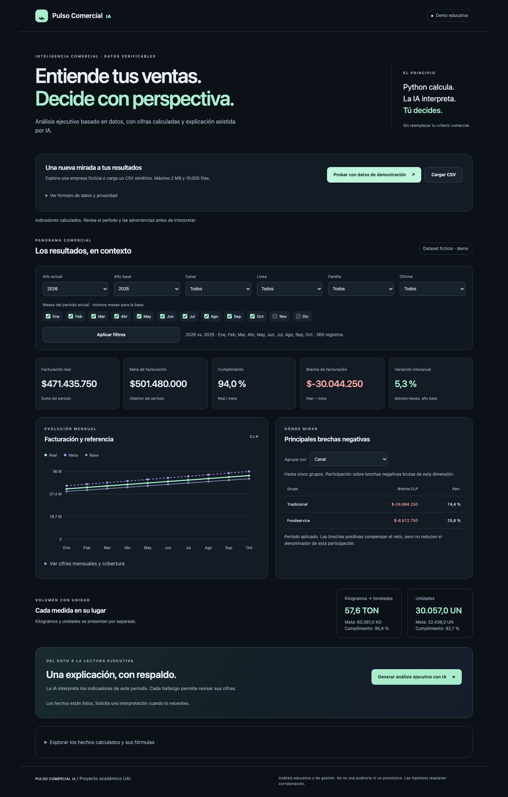

# Pulso Comercial IA

Copiloto ejecutivo de ventas: **Python calcula y valida; el LLM interpreta; el usuario decide.**

Estado al 13-11-2026: **aplicación pública con IA real** verificada mediante HTTP.

- Aplicación: https://pulso-comercial-ia-njsqy6x3ka-tl.a.run.app
- Repositorio: https://github.com/fbahamondesc1992/pulso-comercial-ia
- Modelo `gpt-6.1-sol`, prompt `v2`, revisión `pulso-comercial-ia-00002-2gq`.
- Demo y salud HTTP 200; análisis real con tres hallazgos y referencias válidas.
- Suite local: 166 pruebas sin red. Falta validación visual pública y video final.

Evaluación G1: tope USD 2 y 66 intentos; compromiso conservador USD 1,1850625,
incluyendo reserva íntegra de validación pública. El usuario confirmó límite OpenAI
USD 5 aplicado y autoriza al docente todo el cupo restante. Ver
[despliegue](docs/DESPLIEGUE.md) y [costos](docs/COSTOS_Y_LIMITACIONES.md).



## Cliente, problema y negocio

Para dueños y gerencias comerciales de pymes distribuidoras/mayoristas que consolidan
ventas y metas en planillas. La carga manual dificulta comparar períodos y detectar
brechas. El producto reúne indicadores verificables y una explicación ejecutiva con
evidencia. La promesa «de una planilla a una explicación en minutos» es una hipótesis
de valor, no una medición de productividad.

La IA aporta síntesis y preguntas de investigación, con referencias a cifras del motor.
La diferenciación es la trazabilidad y la separación entre cálculo e interpretación.
Monetización propuesta: SaaS B2B mensual por empresa/equipo o cupo de análisis; demo
gratuita. No hay precio validado, clientes pagadores demostrados ni cobros implementados.
Escenarios operativos: [costos y limitaciones](docs/COSTOS_Y_LIMITACIONES.md).

## Ejecutar localmente

Requiere Python 3.12. No usar el Python 3.9 del sistema inspeccionado.

```bash
python3.12 -m venv .venv
.venv/bin/python -m pip install -r requirements-dev.txt
.venv/bin/python app.py
```

Abrir http://127.0.0.1:8080. La app escucha solo localmente en este modo.
En el entorno ya preparado bastan el último comando y el navegador.
No se requiere credencial para usar datos, filtros y KPIs.

1. Pulsar «Probar con datos de demostración» o cargar un CSV ficticio.
2. Seleccionar años, meses y dimensiones; aplicar filtros.
3. Revisar cobertura, metas, volumen por unidad y rankings.
4. Solicitar IA cuando el servicio esté autorizado y habilitado.
5. Expandir evidencia de cada hallazgo y revisar fórmula, período, unidad e ID.

Sin configuración de IA aparece un error recuperable y un **Resumen automático sin IA**.
No se simula una respuesta real. Al cambiar filtros se invalida el análisis previo.

## Configuración

`.env.example` contiene solo nombres y valores de ejemplo. Al ejecutar directamente
`.venv/bin/python app.py`, se carga el `.env` local sin sobrescribir variables del
proceso ni interpolar expresiones. Importar la app en pytest o Gunicorn no carga .env.
En local configurar variables en el proceso, nunca copiar una clave al chat, código o
comandos guardados. En producción referenciar Secret Manager.

| Variable | Valor inicial / efecto |
|---|---|
| PORT | 8080 |
| AI_ENABLED | false; requiere activación expresa después de G1 |
| OPENAI_API_KEY | Solo servidor, nunca frontend ni repositorio |
| AI_MODEL | gpt-6.1-sol; conexión real verificada |
| ANALYST_PROMPT_VERSION | v2, candidata sin mejora real medida |
| AI_TIMEOUT_SECONDS | 20 por intento, máximo admitido 30 |
| AI_MAX_OUTPUT_TOKENS | 1800, rango admitido 256..2400 |
| AI_REQUESTS_PER_IP_HOUR | 5 por proceso |
| AI_REQUESTS_GLOBAL_HOUR | 30 por proceso |

## Datos y metodología

`datos/demo_ventas.csv`: 360 filas ficticias, enero-octubre 2025/2026, tres canales,
dos líneas/familias, tres oficinas, KG y UN. Regenerable con
`.venv/bin/python scripts/generar_demo.py`.
CSV UTF-8 con `;` y coma decimal (Chile), o con `,` y punto decimal. Sin separadores de miles; acepta valores reales negativos y conserva todos los decimales. Las metas deben ser no negativas.
Contrato completo: [diccionario](datos/DICCIONARIO_DATOS.md).

Facturación y meta son sumas Decimal; brecha=real-meta; cumplimiento=sum(real)/sum(meta).
YoY compara mismos meses con cobertura comprobada a nivel de grano. Ausencias no son
ceros; meta parcial invalida tasas/brecha afectadas. CLP entero y porcentajes con un
decimal, ROUND_HALF_UP al mostrar. KG y UN separados; KG/1000 a TON en presentación.
Las participaciones de brecha usan negativas brutas de una sola dimensión.

## Arquitectura y estructura

```text
Navegador: archivo en memoria + filtros
  → Flask / validador_csv.py
  → indicadores.py (Decimal y cobertura)
  → dashboard + hechos con IDs
  → analista_ia.py + prompts versionados + OpenAI
  → Pydantic / referencias / política numérica / restricciones
  → explicación o error seguro
```

`app.py`: rutas y seguridad HTTP; `schemas.py`: contratos; `templates`/`static`: UI;
`datos`: demo/diccionario; `prompts`: sistema v1/v2; `golden_set`: diez casos;
`scripts`: evaluación y verificación; `tests`: regresión; `docs`: metodología y entrega;
`evidencias`: resultados reales y pendientes claramente rotulados.

No hay base de datos. Cada petición vuelve a validar y calcular el archivo. Nunca se
confía en KPIs enviados por el navegador. El snapshot vincula informe/dataset/filtros.
El proveedor recibe solo agregados con alias; no recibe el CSV original.
La prosa de IA usa marcadores de hechos; Python inserta cifras y unidades. Las reglas
semánticas automáticas no garantizan por sí solas que toda interpretación sea correcta.

Rutas: `GET /`, `GET /health`, `GET /demo.csv`, `POST /api/dashboard`,
`POST /api/analisis`. Las APIs requieren `X-Pulso-Request: 1`; no admiten CORS público.
`/health` no llama al proveedor y un 200 no certifica que la IA esté disponible.

## Pruebas y evaluación

```bash
.venv/bin/python -m pytest -q
.venv/bin/python scripts/evaluar_prompts.py
.venv/bin/python scripts/evaluar_prompts.py --modo mock --salida evidencias/04_mock_nueva_corrida.json
```

Prueba puntual autorizada: `.venv/bin/python scripts/probar_conexion_ia.py --ejecutar`.
Lee la clave de .env, realiza un intento con 512 tokens máximos de salida y no imprime
el cuerpo de errores ni la credencial. No sobrescribe evidencia existente; para una
clave reemplazada usar una nueva ruta `--salida`. La prueba de la nueva clave está en evidencias/13_conexion_ia_corregida.json.
AI_ENABLED=false conserva deshabilitado el gasto desde el dashboard.

Pytest bloquea red. Golden set con cliente falso verifica infraestructura, no calidad
de IA. [Protocolo y comparación pendiente](docs/MEJORA_PROMPTS.md).
La evaluación real está autorizada dentro del límite acumulado de USD 2.
El script conserva resultados por caso, se detiene antes de superar su reserva y no
sobrescribe evidencias. Repetirlo no renueva una autorización de gasto.

Prueba de navegador: `node scripts/verificar_ui.cjs`, con Playwright disponible;
`PLAYWRIGHT_MODULE_PATH` permite señalar la instalación y `PLAYWRIGHT_BROWSERS_PATH`
su Chromium. Los binarios de esta revisión se instalaron dentro de `.venv`.
La revisión verifica demo, filtros, errores, fallback y ausencia de desbordes a 375/1440.
No acredita experiencia móvil en dispositivo físico ni producción.

## Docker y despliegue

```bash
docker build -t pulso-comercial-ia:local .
docker run --rm -p 127.0.0.1:8081:8080 -e PORT=8080 pulso-comercial-ia:local
curl -i http://127.0.0.1:8081/health
```

El 8081 evita colisión con el servidor local 8080. El contenedor utiliza Gunicorn,
un worker/cuatro threads y usuario sin privilegios. `.dockerignore` es una lista de
inclusión de archivos de ejecución. La imagen no incluye evidencia, tests ni secretos.
Estado efectivo del build: consultar [bitácora](docs/BITACORA_ENTREGA.md).

Publicado en Cloud Run Santiago bajo G3, HTTPS sin login.
Configuración y límites en [despliegue](docs/DESPLIEGUE.md).
G2 completado: código público y acceso sin autenticación comprobados; SHA local/remoto
conciliado. Ver evidencias/12_github_publicado.json. Auditoría antes de cada push.

## Seguridad, actualización y límites

CSV en memoria, máximo 8 MiB/30.000 filas; no se aceptan pickle/eval ni comandos.
Escaping por textContent/Jinja; CSP sin scripts externos/inline; cabeceras defensivas.
Sin logs de archivos/prompts privados; errores no exponen stack traces ni credenciales.
Auditar con `.venv/bin/python -m pip_audit -r requirements.txt` y revisión de secretos
antes de publicar. La auditoría reporta vulnerabilidades conocidas en la fecha, no
ausencia absoluta de vulnerabilidades. Versiones directas/transitivas fijadas; para
actualizar, resolver en entorno aislado, revisar cambios y repetir suite/auditoría/build.
La base Docker quedó fijada a versión y digest verificado durante el build local.

Contadores de solicitudes son volátiles por proceso. No garantizan gasto máximo.
Alertas cloud CLP 4900, límite OpenAI aplicado USD 5 y Secret Manager configurados.
Demo limitada a 2 solicitudes/IP/h y 3 globales/h; el público puede consumir el cupo.
MVP sin login, ERP, persistencia, usuarios, RAG, pronósticos, precios ni datos reales.

## Entrega y apagado

- [Matriz completa](docs/MATRIZ_CUMPLIMIENTO.md), [bitácora](docs/BITACORA_ENTREGA.md).
- [Ficha de negocio PDF](docs/FICHA_NEGOCIO.pdf): versión final de una página con modelo, costos, fuentes y URLs vigentes.
- [Guion de video](docs/VIDEO_GUION.md): no sustituye grabación real.
- URL pública: PENDIENTE; video: NO GRABADO. GitHub enlazado al inicio.

Detener local: Ctrl+C en el proceso Flask/Gunicorn. Contenedor: detener su ID con
`docker stop ID`; se elimina al usar --rm. No borrar imágenes ni recursos ajenos.
En cloud, mantener la app durante corrección; tras fecha acordada, deshabilitar IA y
retirar servicio/revisiones, imágenes, secretos y recursos propios con autorización.
Verificar facturación residual de almacenamiento/logs; detener la app no elimina todo costo.

## Paquete local para revisión

`.venv/bin/python scripts/preparar_entrega.py` genera
`entrega/Pulso_Comercial_IA_MVP_LOCAL.zip` con lista explícita, manifiesto SHA256
y revisión de credenciales. `.env`, entornos, caches y PDF original del curso
quedan fuera. La carpeta entrega está excluida de Git.

[Registro de publicación](docs/REVISION_PUBLICACION.md): G2 autorizado para
fbahamondesc1992/pulso-comercial-ia, público. G3 recibido; despliegue en proceso.
El ZIP anterior representa el cierre local previo a G2; su manifiesto fecha ese estado.

Actualización de modelo: GPT-6.1 Sol, low, Standard y caché de 30 minutos.
Las evidencias vigentes de evaluación y presupuesto se registran en la fase 13.
Verificación local anterior: 96 pruebas sin red, imagen Linux amd64 con python-dotenv,
salud/dashboard 200, revisión responsive y recuperación de CSV inválido.
Evidencias de esta versión en `evidencias/11_*`.

## Revisión de pauta y evaluación real

[Brechas de cierre](docs/BRECHAS_PAUTA_FINAL.md) contrasta los cinco criterios y los
cuatro entregables del PDF formal. Veinte casos reales: v1 80%, v2 70%, sin mejora
positiva en la corrida original. Correcciones y aprobación humana global descritas abajo. Compromiso
conservador USD 0,5843775 del tope USD 2, no factura. Suite de fase 13: 100 pruebas
aprobadas; Docker actualizado y verificado. Evidencias: `evidencias/13_*`.

Correcciones locales posteriores: [detalle y límites](docs/CORRECCIONES_LOCALES.md).
139 pruebas aprobadas; revalidación sin API de las salidas guardadas: 9/10 v1 y
10/10 v2. Son resultados del evaluador corregido, no una nueva evaluación real
ni evidencia independiente de mejora del prompt. Evidencias de fase 13 preservadas.

[Revisión semántica y técnica](docs/REVISION_SEMANTICA.md): 23 respuestas revisadas
por el asistente (no revisión humana), dos observaciones en v1, 149 tests sin red,
revalidación sin cambios y presupuesto intacto. Evidencias de fase 15.

Aprobación humana global recibida el 12-11-2026; registro independiente con hashes en
`evidencias/16_aprobacion_revision_humana.json`. Se conservan las observaciones v1
y la evidencia original. La repetición real final y el despliegue siguen pendientes.

## Evaluación final real

[Informe final](docs/EVALUACION_FINAL.md): v1 9/10 y v2 10/10, +10 puntos porcentuales
tras el reintento permitido. V2 requirió dos reintentos por falsos positivos del filtro;
al primer intento fueron 9/10 y 8/10. Se selecciona técnicamente v2 para el MVP,
sin afirmar superioridad estadística general. Revisión humana nueva pendiente.
152 pruebas locales sin red. Costo superior nuevo USD 0,264685; compromiso acumulado
USD 0,8490625 de USD 2, incluyendo reservas históricas. Billing no consultado.
Evidencias `17_*`; 22 llamadas nuevas, 48 intentos acumulados de 66 autorizados.

Estado vigente fase 18: F4 cerrado por aprobación global explícita del usuario;
selección técnica v2 confirmada para el MVP. Evidencia 18_cierre_f4_inicio_f6.json.
Los campos individuales históricos no se rellenan ni alteran. F6 en preparación,
G3 recibido, disponibilidad solicitada hasta 30-11-2026 (Chile). Ver PLAN_F6.md
en docs/.

Estado F6 al 13-11-2026: proyecto, APIs, repositorio de imágenes y cuenta runtime
creados. Resultado de subida de imagen y servicio pendientes de verificar. Control
del navegador no disponible; ver `docs/DESPLIEGUE.md` y `evidencias/19_avance_f6.json`.

Estado vigente: fase 21 desplegada y validada por HTTP; las notas anteriores de
fases 13–20 son históricas. F6 espera validación visual; F7 espera video/ficha finales.

## Estado tras aprobación F6 (13-11-2026)

F6 cerrada por aprobación humana; ver `evidencias/28_aprobacion_f6.json`.
F7 abierta: ficha PDF vigente, video real y revisión final de evidencia visual.
La aprobación no reemplaza las verificaciones visuales pendientes.

## F7 · revisión del 13-11-2026

Ficha PDF actualizada y revisada visualmente. HTTP público de inicio, health, demo CSV y dashboard sintético: 200. Capturas visuales públicas y video real siguen pendientes de grabación.
